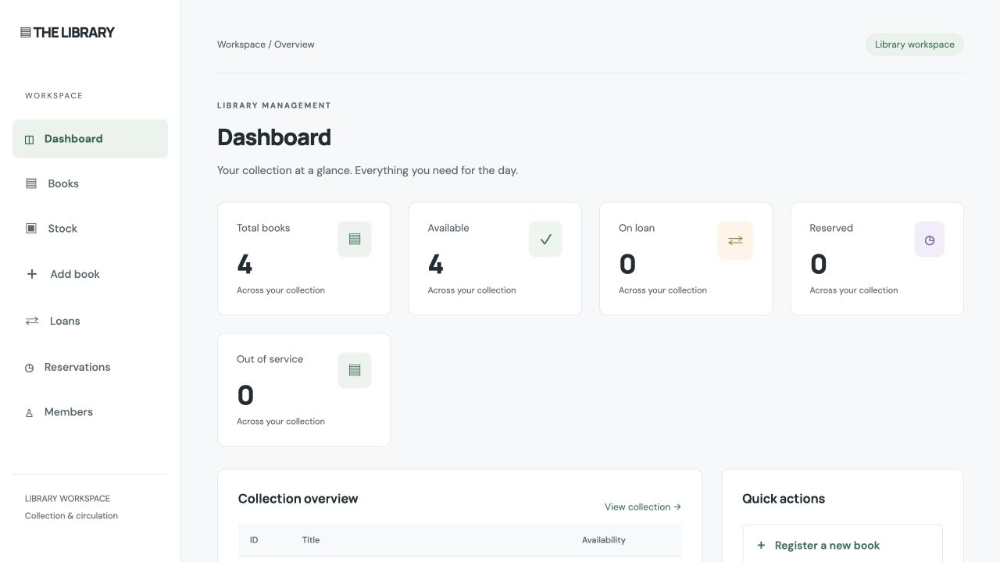

# Library management system in C

## ▶ Watch the project demo

[](https://github.com/Probir127/CSA0234-PROBIR-1911260319/raw/refs/heads/main/Caption%20project/demo/capstone-demo.mp4)

**[▶ PLAY VIDEO — 2 minutes 8 seconds](https://github.com/Probir127/CSA0234-PROBIR-1911260319/raw/refs/heads/main/Caption%20project/demo/capstone-demo.mp4)**

See the actual application being used: add and search books, register members,
check out and renew loans, place a reservation, return books, and manage stock.
The video is silent with an optional subtitle track.
[Demo guide and recording details](demo/README.md).

## Presentation and documentation

- [Team 7 presentation (PowerPoint)](documentation/Team%207%20Library%20Project.pptx)
- [Team 7 capstone report (PDF)](documentation/Team%207%20Library%20Management%20Capstone%20Report.pdf)

A terminal client communicates with a multithreaded TCP server. All application
code is C, using POSIX sockets and pthreads. Works on macOS and Linux.
No third-party libraries are required.

## Run in VS Code

Open this `captionproject` folder in VS Code. Choose **Terminal → New Terminal**.

Build both programs:

```sh
make
```

In the first terminal start the server:

```sh
./server
```

Open a second terminal using the **+** button, then start the client:

```sh
./client
```

Use the numbered menu to list, search, add, borrow, or return books. Each added
book gets a unique ID. Each entry represents one physical copy; add another
entry for another copy. A return requires the same borrower name used at checkout.
Names and search terms are case-sensitive. Fields accept up to 158 bytes through
the interactive client. Choose `0` to exit the client; use Ctrl+C to stop the server.
You can run more clients in additional terminals.

Records are saved after every successful change in `library.tsv` in the server's
working directory and loaded on restart. Failed saves roll back the operation.
Do not edit the data file while the server runs. Use one server per data file.
There are at most 1000 books. No sample books are added automatically.

## Connect from another computer

On the server computer:

```sh
./server 5050 0.0.0.0
```

On another macOS/Linux computer, build the client and substitute the server's LAN
IPv4 address:

```sh
./client 192.168.1.10 5050
```

Both computers must be able to reach TCP port 5050. The default server binds to
`127.0.0.1` for local use. This is an educational trusted-network application:
there is no authentication or encryption, and connected clients can add books
and submit borrower names. Do not expose it to the public internet. Idle client
connections expire after 60 seconds; run the client again to reconnect.

Optional arguments:

```text
./server [port] [bind_ipv4] [database_path]
./client [server_ipv4] [port]
```

## Files and communication

- `server.c`: threaded TCP server, validation, book operations and persistence.
- `client.c`: interactive terminal client.
- `protocol.h`: complete sends and newline-delimited TCP frame reads.
- `Makefile`: compile with strict warnings.
- `test_system.py`: integration tests only; requires Python 3, not needed to run the app.
- `.vscode/tasks.json`: VS Code build task (Cmd+Shift+B on macOS).

Requests are UTF-8 text lines with tab-separated fields:

```text
LIST
SEARCH<TAB>keyword
ADD<TAB>title<TAB>author
BORROW<TAB>book_id<TAB>borrower
RETURN<TAB>book_id<TAB>borrower
QUIT
```

Replace `<TAB>` with a literal tab. Responses end with a line containing `END`;
`QUIT` closes the connection. Newlines and tabs are not allowed inside fields.
A mutex serializes library changes to prevent two clients borrowing the same copy.
Snapshots use a temporary file and rename to avoid partially written records.

## Verification

```sh
make check
```

Tests exercise real TCP connections, the C client's menu, validation, persistence
across restart, simultaneous borrowing, and split/combined TCP frames.

## Browser interface

Run `make` and `./server` from this folder, then visit
http://127.0.0.1:5050 in your browser. The interface supports searching, adding,
borrowing and returning books using the same C server and saved records.
Keep `interface.html` in the server's working directory.

## Registered circulation

Use **Members** to register a name and unique email. On **Loans**, select an
available copy, a registered member and a loan period of 1–60 days (default 14).
The server enforces at most five active loans per member. The loan register shows
active, overdue and returned loans. Return using the register's Return button;
returned transactions remain in history. Due dates are elapsed 24-hour periods.
Book details can be corrected on the Books page using the book ID.

Member and loan records are saved atomically alongside books in the same data
file, with `M` and `L` record prefixes. Existing book records remain readable.
Back up the data file before moving it to another computer. Older name-only loans are shown in the loan register after restart. Their issue
and due dates remain unknown. They can be returned through the browser or the
terminal client; registered loans use CHECKIN or the browser.

Additional TCP commands (tab-separated): MEMBERS, MEMBER_ADD name email,
LOANS, CHECKOUT book_id member_id days, CHECKIN loan_id, EDIT book_id title author.
This remains a local operator application without login, roles, or encryption;
registered membership identifies borrowers and does not authenticate users.

## Reservations and renewals

Use **Reservations** to queue a registered member for a specific copy. Pending
reservations survive a server restart and appear in the queue. The first member
in line gets checkout priority after the copy is returned; other members are
blocked by the server. A pending reservation can be cancelled. Checkout fills
the first reservation for that copy. A reserved copy is listed separately from
an unrestricted available copy.

On **Loans**, use **Renew** to extend an active dated loan by 14 days. The C
server allows at most two renewals, and blocks renewal when anyone is waiting
for the copy. Legacy loans with unknown due dates cannot be renewed. The
renewal count and reservation history are saved alongside books and members.

Additional tab-separated TCP commands: `HOLDS`, `HOLD book_id member_id`,
`CANCEL_HOLD hold_id`, and `RENEW loan_id days` (1–30 days). New records are
stored as `H` lines; existing `L` lines remain readable. This implementation
uses copy-level reservations and fixed loan rules, with no automated notices,
fines, authentication or multiple branches.

## Stock management

The **Stock** page tracks individual physical copies and totals by title. Receive
1–50 copies of a title at once, each with its own ID. Mark an unloaned,
unreserved copy as **Damaged** or **Lost**, or choose **Remove copy** to withdraw
it from stock. Removed copies no longer count as stock and cannot be borrowed or
reserved. Their records remain visible under the Removed filter, where **Restore
copy** puts them back on the shelf. The server rejects status changes for
borrowed or reserved copies; return the loan or clear the reservation first.

Existing book records load as active stock. The first successful save writes a
new `B` record format that also stores each copy's stock status. Keep a backup
of `library.tsv` before using the new version with older copies of the program.
Additional commands: `STOCK_ADD title author quantity` and
`STOCK_SET book_id ACTIVE|DAMAGED|LOST|REMOVED`.
