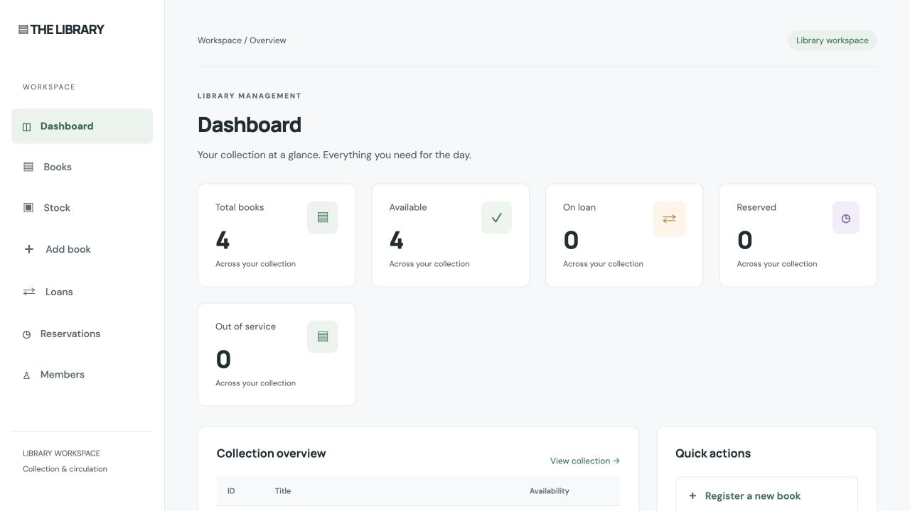

# Library Management System — Usage Demo

[](https://github.com/Probir127/CSA0234-PROBIR-1911260319/raw/refs/heads/main/Caption%20project/demo/capstone-demo.mp4)

**[Watch or download capstone-demo.mp4](https://github.com/Probir127/CSA0234-PROBIR-1911260319/raw/refs/heads/main/Caption%20project/demo/capstone-demo.mp4)**

Duration: **2:08** · Format: **1280 × 720, H.264 MP4** · Audio: **silent**.
The file includes an optional subtitle track; the separate
[SRT file](capstone-demo.srt) is also available.

## What the video demonstrates

| Time | Workflow |
| --- | --- |
| 00:00 | Start with an empty dashboard |
| 00:04 | Add two books and browse the catalogue |
| 00:21 | Search by title |
| 00:27 | Register two demonstration members |
| 00:40 | Check out a copy and review the due date |
| 00:53 | Renew the loan |
| 00:57 | Place a reservation for a waiting member |
| 01:06 | Observe renewal blocked by a pending reservation |
| 01:10 | Return the book; checkout priority goes to the waiting member |
| 01:18 | Issue the reserved copy to that member |
| 01:25 | Return the copy and inspect both loan histories |
| 01:30 | Review the fulfilled reservation |
| 01:34 | Receive two copies into stock |
| 01:44 | Mark a copy damaged and filter by status |
| 01:55 | View a removed copy, then restore it to stock |
| 02:03 | Review the updated dashboard |

## Run the same application

From the `Caption project` folder:

```sh
make
./server 5050 127.0.0.1 demo-library.tsv
```

Open **http://127.0.0.1:5050/**. This starts a separate data file if
`demo-library.tsv` does not exist. Stop with Ctrl+C. Follow the forms in the
video using example names and emails such as `Alex Demo` and
`alex.demo@example.com`. The application stores changes through the actual C
server; the interface does not simulate the operations.

## Recording and checks

Recorded on 23 November 2026 from the existing capstone application using a
separate temporary database and fictional member data. The video is an edited
sequence of **38 real browser screen captures**, held long enough to read.
Some close-ups were retaken with the same demonstration state to show results
clearly. It is not continuous real-time capture; no UI results are simulated.

[capture-log.json](capture-log.json) contains action labels and screen durations.

The project compiled with C11 and strict warnings treated as errors. The
demonstrated workflows were operated through visible forms. Saved records
contained four books, two members, two returned loan histories, and one fulfilled
reservation. Read-only LIST, MEMBERS, LOANS, and HOLDS requests were checked
against the C server. The final MP4 was decoded end to end without FFmpeg errors,
and encoded frames were visually inspected.

Secondary text and status labels were darkened to meet at least 4.5:1 contrast
on their light backgrounds. Table-action hover styles were corrected so their
labels remain readable. The design-hook findings were fixed; no suppressions
were added and none of the flagged issues were left unresolved.

The existing repository snapshot does not contain the `test_system.py` referenced
by `make check`; that target was not used as evidence for this recording.
