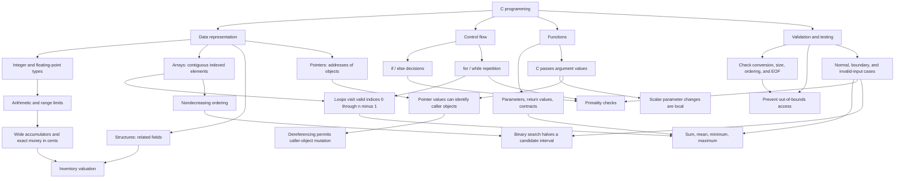

# C Programming Concept Map

Arrows describe relationships rather than a required learning order.

## Read the map as propositions

1. An array stores elements of one type; loops access them using valid indices.
2. An accumulator combines array values; its type must accommodate the total.
3. A structure groups fields such as quantity and price for one inventory item.
4. Functions split a problem into components with input and output contracts.
5. All C function arguments are passed by value. Passing an address copies a
   pointer value, through which a function can modify the pointed-to object.
6. Binary search needs ordered input and repeatedly reduces the candidate range.
7. Validation establishes preconditions; tests provide evidence for selected cases.

## Worked concept check

**Why do arrays, loops, functions, and testing connect in the statistics activity?**
The array holds the observations, loops inspect each observation, functions
encapsulate separate calculations, and tests check outcomes for positive,
negative, singleton, and extreme values. Each concept has a distinct role in
making the complete program understandable and dependable.
