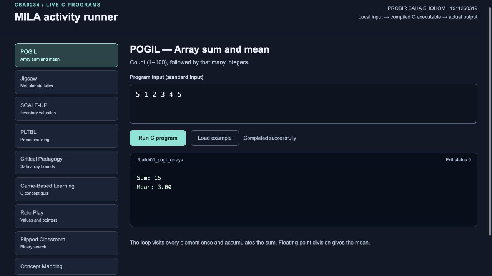

# Using the MILA Project — Video Demo

[](https://github.com/Probir127/CSA0234-PROBIR-1911260319/raw/refs/heads/main/MILA/demo/mila-demo.mp4)

**[Watch or download the usage demo](https://github.com/Probir127/CSA0234-PROBIR-1911260319/raw/refs/heads/main/MILA/demo/mila-demo.mp4)**

**PROBIR SAHA SHOHOM · 1911260319 · CSA0234**

The **1:38 MP4** shows actual browser operation: select an activity, enter input,
press **Run C program**, and read the real output. It includes changing values,
invalid input, a partially correct quiz, and a missing search target. All eight
C programs and concept relationships are shown. The video is silent; input,
output, and status messages are visible on screen.

## Run the project yourself

From the repository root:

```sh
cd MILA
make
python3 demo/run_project.py
```

Open **http://127.0.0.1:5088/**. Requirements: a C11 compiler, Make, and Python 3.
No Python packages are needed. The Python server binds to loopback and invokes
only the eight known C executables. It passes the text area to standard input
and displays standard output, standard error, and exit status. Calculations and
validation remain in the C programs.

1. Select an activity on the left.
2. Enter whitespace-separated values in **Program input** using the displayed
   format. Newlines and spaces both separate integer tokens.
3. Choose **Run C program**. Successful execution shows exit status 0.
   Invalid C input shows status 1 and `Invalid input`.
4. Change the input and run again. **Load example** restores the sample input.
5. Choose **Concept Mapping** to review relationships between C topics.

Stop the server with Ctrl+C. To use another local port:
`python3 demo/run_project.py --port 5089`, then open that port instead.

## Try the video scenarios

| Activity | Input | Result |
| --- | --- | --- |
| POGIL | `5 1 2 3 4 5`, then `3 10 20 30` | Sum/mean change from 15/3.00 to 60/20.00 |
| Jigsaw | `5 12 7 19 7 5` | Minimum 5, maximum 19, sum 50, mean 10.00 |
| SCALE-UP | `3 2 1250 3 499 0 999` | 3997 cents / 39.97 |
| PLTBL | `97`, then `49` | Prime, then not prime |
| Critical Pedagogy | `101`, then `3 10 -2 5` | Rejected count, then sum 13 |
| Game-Based Learning | `1 1 3 2 2` | Per-question feedback and score 3/5 |
| Role Play | `10 20` | Value call leaves caller unchanged; pointer call swaps values |
| Flipped Classroom | `5 2 4 6 8 10 8`, then change target to `7` | Index 3, then -1 |
| Concept Mapping | Select its navigation button | Relationships among C topics |

The quiz questions are visible before entering choices. The diagram activity
has no executable or Run button.

## Recording and verification

The video uses **42 actual in-app browser screenshots** captured while operating
the live runner on 23 November 2026. Screens are held for readability: this is an
edited sequence of interaction checkpoints, rather than a continuous real-time
capture. Outputs are not simulated or redrawn. Format: 1280 × 720, H.264 MP4.

- [capture-log.json](capture-log.json): verified scenarios and screen timings.
- [mila-demo.srt](mila-demo.srt): optional subtitles describing the actions.
- [run_project.py](run_project.py): local interface used in the video.
- [Activity report](../ACTIVITY_REPORT.md): all nine worked learning methods.
- [Verification record](../VERIFICATION.md): C build and sanitizer evidence.

The C suite passes all nine test groups. The runner passes four integration test
groups covering executable results, rejected input, unknown programs, request
types/size, cross-origin requests, and page loading. Repeat with `make test` and
`make test-runner` from `MILA/`. The MP4 was decoded end to end with FFmpeg and
encoded frames were visually inspected. The video does not claim group
participation, instructor approval, or an official grade.
